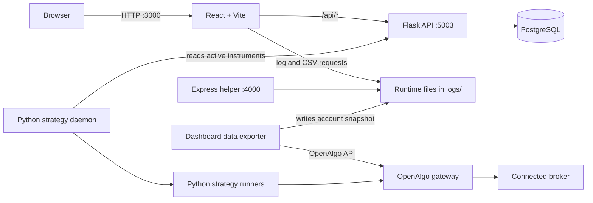

# React Trading Dashboard: Resume and Project Profile

**Purpose:** A detailed, resume-ready reference for the React dashboard in this repository. It records the product scope, technical architecture, capabilities, data flow, operating model, and important limitations. It is not a substitute for the operator setup guide in [REACT_DASHBOARD_DOCUMENTATION.md](REACT_DASHBOARD_DOCUMENTATION.md).

**Repository snapshot:** October 30, 2026. Runtime status and broker mode can change; the dated observations below are not configuration guarantees.

## Project Summary

The React Trading Dashboard is the browser-based operations and monitoring interface for an automated options-trading application. It gives operators a consolidated view of account balances, positions, orders, analytics, strategy activity, and instrument configurations. It also provides the configuration UI used to manage instruments that the backend strategy daemon reconciles into Python strategy processes.

The dashboard is part of a larger system. It does not evaluate trading signals or submit, modify, or cancel broker orders. Python strategy runners perform that work through the configured OpenAlgo service. The browser presents broker snapshots and strategy/runtime records produced by backend services.

## Resume-Ready Description

> React and TypeScript dashboard for an automated options-trading platform, integrating live account snapshots, positions, orderbook monitoring, analytics, strategy logs, and instrument configuration with Python/Flask services, PostgreSQL, Docker Compose, and an OpenAlgo broker gateway.

The description should be tailored to the candidate's actual ownership. The bullets below are drafting material, not claims about an individual's role.

### Resume Bullet Drafts

- Built and maintained a React 18 and TypeScript trading operations dashboard with account, positions, orderbook, analytics, logs, and instrument-management workflows.
- Integrated frontend pages with Flask REST endpoints, PostgreSQL-backed instrument configuration, OpenAlgo account snapshots, and file-based strategy monitoring data.
- Implemented real-time-style dashboard refresh and CSV-based log/alert ingestion for operator visibility into strategy events and broker account state.
- Connected instrument configuration workflows to a Python strategy daemon that reconciles active instruments and manages strategy runner processes.
- Containerized the frontend and backend workflow with Docker Compose, separating the React UI, Flask/API worker, strategy manager, and account-data exporter.
- Added operational safeguards and clear UI boundaries so snapshot views are not presented as order-entry controls or as proof of a running strategy process.

Do not add user counts, uptime, trading returns, throughput, latency improvements, or other quantitative outcomes unless independently measured and verified.

## Product Scope and User Workflows

| Area | Route | Primary capability |
| --- | --- | --- |
| Dashboard | `/`, `/dashboard` | Account MTM, available margin, active positions, strategy label, and broker identity reported by OpenAlgo. |
| Positions | `/positions` | Read-only view of current account positions, prices, quantities, P&L, and CSV export. |
| Orderbook | `/orderbook` | Read-only broker order and execution monitoring with status summaries and CSV export. |
| Analytics | `/analytics` | P&L and trade summaries, equity/trade charts, daily P&L calendar, monthly summary, CSV export, and analytics reset controls. |
| Instruments | `/instruments` | Create, edit, activate/deactivate, search, filter, and archive instrument/strategy configurations. |
| Logs | `/logs` | Strategy monitoring history, setup/candle context, ATM locks, triggered alerts, filters, reset/hide controls, and export. |

The shared application shell provides sidebar navigation, dark/light theme selection, page layout, and toast notifications. The frontend is an operational interface; the broker order views are for monitoring and do not provide order-entry or order-management actions.

## Technology Stack

| Layer | Technologies | Responsibilities |
| --- | --- | --- |
| Frontend | React 18, TypeScript 5, React Router 6 | Page rendering, route navigation, typed UI behavior, and reusable components. |
| Styling and UI | Tailwind CSS 3, custom CSS, Lucide React, `clsx` | Responsive visual styles, theme tokens, icons, and conditional classes. |
| Charts and data presentation | Recharts, PapaParse, `date-fns` | Analytics charts, CSV parsing, and date handling. |
| Frontend state | Zustand with persistence middleware | Shared UI state and selected browser-local preferences. |
| Development/build | Vite 5, TypeScript compiler, ESLint | Local frontend server, `/api` proxy, log-file serving, static production build, and frontend checks. |
| Helper server | Node.js, Express 4 | Log-file access, health check, alert/analytics reset operations, and legacy compatibility routes. |
| API and persistence | Python, Flask, SQLAlchemy, PostgreSQL | Instrument CRUD, symbol operations, analytics APIs, and durable configuration records. |
| Strategy runtime | Python strategy daemon and runners, OpenAlgo | Active-instrument reconciliation, strategy execution, broker account/order/position access, and trading operations. |
| Local orchestration | Docker Compose | Coordinates React, API/worker, strategy daemon, data exporter, and legacy Streamlit service. |

Dependency versions and scripts are defined in [frontend-react/package.json](frontend-react/package.json). Backend and infrastructure wiring are described in [docker-compose.yml](docker-compose.yml).

## Architecture and Data Flow



### Component Responsibilities

- **React/Vite:** Serves the user interface. Vite forwards `/api/*` requests to the Flask API and includes development middleware to serve supported files from `logs/`.
- **Express helper:** Runs on port `4000`; serves selected runtime files and implements reset/legacy routes used by parts of the UI.
- **Flask API:** Serves database-backed instrument and symbol workflows and API-backed analytics/data endpoints.
- **PostgreSQL:** Persists instrument and related application records. It is not defined as a service in this Compose file and must be reachable separately.
- **Dashboard exporter:** Calls the configured OpenAlgo endpoint and writes `logs/dashboard_data.json`, consumed by account-facing pages.
- **Strategy daemon:** Polls the API for active instrument configurations and starts/stops managed strategy runners.
- **Python strategy runners:** Evaluate strategy rules and communicate with OpenAlgo to obtain data and submit trading requests.

## Data Sources and Refresh Behavior

The UI combines API responses, account snapshots, and runtime files. There is no single data store that supplies every screen.

| Data | Producer/source | Consumers |
| --- | --- | --- |
| Account, funds, positions, orders, broker name, and mode | `export_dashboard_data.py` writes `logs/dashboard_data.json` from OpenAlgo data. | Dashboard, Positions, Orderbook, and some analytics endpoints. |
| Instrument configuration and status | Flask API backed by PostgreSQL. | Instruments page and strategy daemon. |
| Strategy monitoring | Dated `logs/monitoring_YYYYMMDD.csv` files. | Logs page setup and candle history. |
| Strategy alerts | Dated `logs/trade_alerts_<symbol>_YYYYMMDD.csv` files. | Logs page alert table and export. |
| Locked option contracts | Dated `logs/atm_lock_<symbol>_YYYYMMDD.json` files. | Logs page. |
| Analytics fallback/history | Analytics CSV/reset files and daily P&L archive/database records. | Analytics page and calendar. |

Typical refresh intervals vary by page: account snapshots are polled about once per second, Orderbook about every five seconds, Analytics about every three seconds, and Logs files about every two seconds. A polling interval does not guarantee that the producer has fresh data or that the broker has confirmed an order state.

Analytics values may have different scopes. Some headline metrics are synthesized from the current snapshot; some trade rows use CSV fallback data; daily history can come from saved archive/database records. Do not treat every chart and headline as one canonical historical ledger.

## Instrument Activation Lifecycle

1. An operator adds or edits an instrument and chooses its symbol, strategy, schedule, sizing, product, and available risk settings in the Instruments page.
2. The React hook sends configuration changes to the Flask API.
3. Flask persists the instrument record in PostgreSQL.
4. The Python daemon polls the API and reconciles records marked active.
5. The daemon starts or maintains the corresponding strategy runner; the runner uses the configured OpenAlgo connection.
6. Strategy and account outputs are written to runtime files or returned through API endpoints for the dashboard to display.

Deactivating an instrument prevents future daemon-managed execution after reconciliation. It does not, by itself, cancel broker orders that already exist or close an open position. Broker state must be checked and managed separately.

The database/API and daemon determine active Docker-managed instruments. Browser local storage and legacy JSON exports are not the authority for the daemon's active instrument list.

## State and Configuration

- Zustand persists selected UI preferences in browser local storage, including the theme and some cached/configuration UI state. Browser storage is not shared across users and is not the durable instrument database.
- OpenAlgo connection settings are supplied through environment configuration, including `OPENALGO_API_KEY`, `OPENALGO_HOST`, and the Docker-facing `OPENALGO_DOCKER_HOST`. Never copy actual secret values into this document or commit them.
- The dashboard displays the broker identifier returned by the authenticated OpenAlgo account endpoint. It does not provide a multi-broker connection manager.
- As of the inspected repository snapshot on 2026-10-30, the persisted dashboard account snapshot reported broker identifier `angel` (displayed as Angel One) and mode `analyzer`. Treat this only as a dated observation, not a permanent setting.
- The current `.env.example` contains commented Fyers placeholders for future reference. They are inactive; React does not read them and strategy-to-broker routing has not been implemented.
- Compose strategy services have separate `MODE` environment settings from the account snapshot's reported OpenAlgo mode. Verify both before assuming the trading environment is live or simulated.

## Repository Map

| File/folder | Role |
| --- | --- |
| [frontend-react/src/App.tsx](frontend-react/src/App.tsx) | App initialization and browser route registration. |
| [frontend-react/src/pages/](frontend-react/src/pages/) | Dashboard, Positions, Orderbook, Analytics, Instruments, and Logs pages. |
| [frontend-react/src/components/](frontend-react/src/components/) | Shared layout, UI, toast, calendar, and monthly summary components. |
| [frontend-react/src/hooks/](frontend-react/src/hooks/) | Account, analytics, file, and instrument data workflows. |
| [frontend-react/src/stores/app.ts](frontend-react/src/stores/app.ts) | Zustand state and local-storage persistence. |
| [frontend-react/src/types/](frontend-react/src/types/) | Shared frontend TypeScript contracts. |
| [frontend-react/src/utils/](frontend-react/src/utils/) | Formatting, file/CSV, and real account-data helpers. |
| [frontend-react/vite.config.ts](frontend-react/vite.config.ts) | Vite plugins, aliases, API proxy, development log serving, and build chunks. |
| [frontend-react/server.js](frontend-react/server.js) | Express file, health, reset, and legacy routes. |
| [api_server.py](api_server.py) | Flask API entry point and API routes. |
| [export_dashboard_data.py](export_dashboard_data.py) | OpenAlgo account snapshot exporter. |
| [strategy_daemon.py](strategy_daemon.py) | Active-instrument strategy process manager. |
| [run_strategy.py](run_strategy.py) | Strategy runner entry point. |
| [docker-compose.yml](docker-compose.yml) | Local service topology and runtime environment wiring. |
| [REACT_DASHBOARD_DOCUMENTATION.md](REACT_DASHBOARD_DOCUMENTATION.md) | Detailed operator guide, setup instructions, and troubleshooting notes. |

## Development, Build, and Deployment

### Local Frontend Development

From `frontend-react/`:

```sh
npm install
npm run dev
```

The Vite UI is served on port `3000`; `npm run dev` also starts the Express helper on port `4000`. Backend-dependent pages additionally require the Flask API, database, and relevant runtime data sources.

### Frontend Validation

From `frontend-react/`:

```sh
npm run type-check
npm run lint
npm run build
```

### Docker Compose

From the repository root, build and start the full configured stack with:

```sh
docker compose up -d --build
docker compose ps
```

The React dashboard is exposed at `http://localhost:3000`; the Express helper is exposed on port `4000`. The strategy worker/API is on port `5003`. PostgreSQL and the OpenAlgo service must be configured and reachable independently.

For Python strategy engine changes, rebuild the strategy services that contain the Python code, typically:

```sh
docker compose up -d --build strategy_worker strategy_daemon
```

For React source changes, the Compose dashboard bind-mounts the frontend source directory; rebuild/restart the `react_dashboard` service when its image or runtime configuration changes.

## Known Boundaries and Verification Notes

- **Not an order terminal:** Positions and Orderbook are monitoring views; the UI is not a substitute for broker-side order/position confirmation.
- **No per-strategy broker routing:** The current dashboard is built around the OpenAlgo-connected account. The commented Fyers template is documentation only, not an active secondary connection.
- **Status labels are not runtime health checks:** A frontend label such as `Ready` or `Active` should not be used by itself as proof that a Python process is alive. Check daemon/container state and logs.
- **Snapshot age matters:** Account pages depend on the exporter updating `logs/dashboard_data.json`; inspect its timestamp and exporter logs if values look stale.
- **Configuration source matters:** Confirm instrument data through Flask/PostgreSQL and runner state through the daemon. A stale UI cache or old log file can outlive an instrument's active status.
- **Instrument JSON export is legacy:** The store includes an `/api/instruments/export` request while Express owns a matching helper route; requests routed through Vite's `/api` proxy target Flask. Verify the actual route before relying on that file export path for runtime configuration.
- **Environment differs by role:** Strategy `MODE`, OpenAlgo-reported snapshot mode, and the launch mode argument to the exporter have distinct responsibilities. Check service configuration and actual API snapshot rather than inferring one from another.
- **Credentials:** Keep API keys, database URLs, and broker credentials in local environment or secret-management systems. This profile intentionally contains no credential values.

## Suggested Interview Summary

“This is a React and TypeScript operator dashboard for an automated options-trading system. The frontend combines broker account snapshots and strategy logs with a Flask/PostgreSQL instrument-management API. Operators configure instruments in the UI; a Python daemon reconciles those records into strategy runners, which communicate with OpenAlgo. The architecture separates monitoring from order execution, and Docker Compose coordinates the frontend, API, daemon, and data exporter.”

Before using this summary on a resume or in an interview, tailor it to the work personally completed and verify the repository's current deployment and broker configuration.